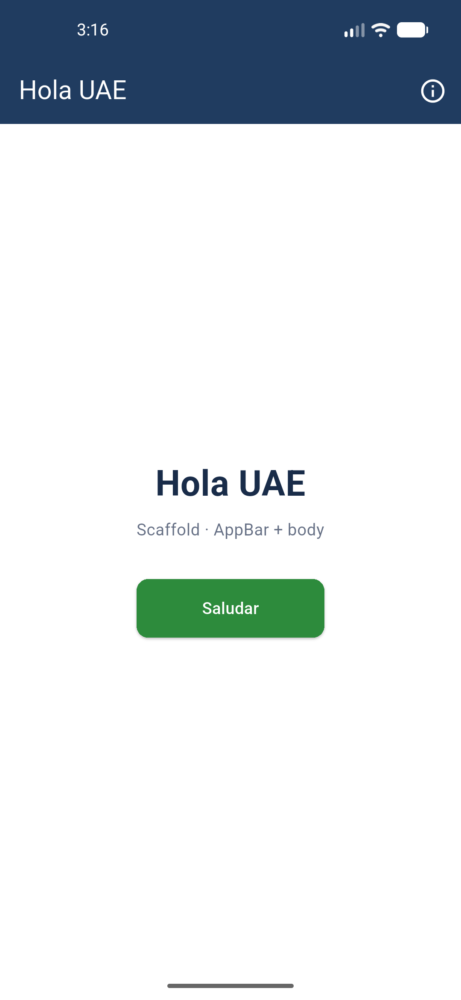
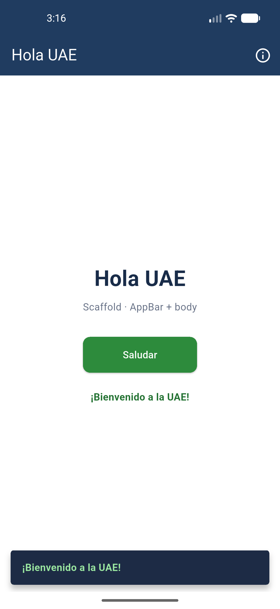
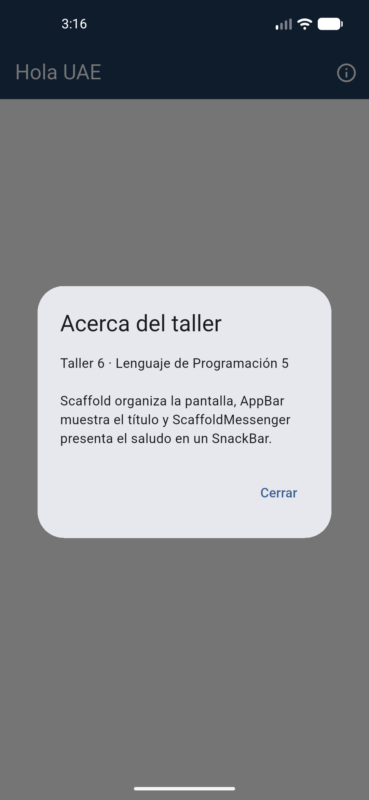
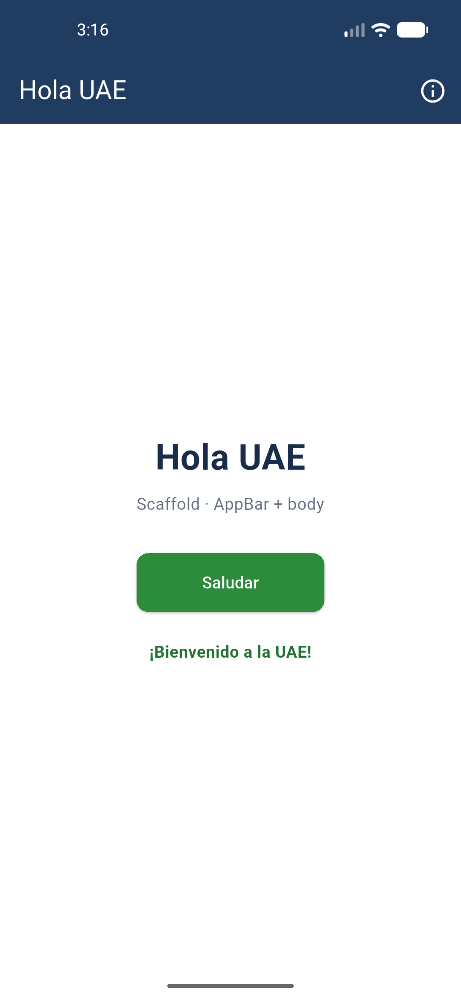
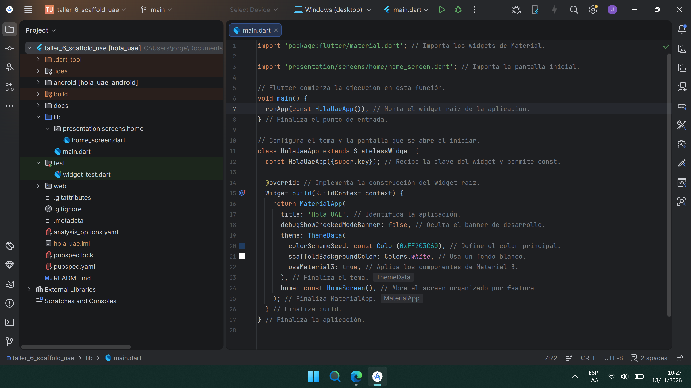

# Hola UAE · Taller 6

**Lenguaje de Programación 5 · Sexto semestre · Universidad Agraria del Ecuador**

Docente: Ing. Bryan Vélez MS.c.

Aplicación Flutter que presenta una pantalla con `Scaffold`, un `AppBar` con el título **Hola UAE** y una acción de información. Al pulsar **Saludar**, muestra **¡Bienvenido a la UAE!** en un `SnackBar` y en un texto de resultado que permanece visible cuando el aviso desaparece.

## Integrantes

**Paralelo 6SB · Grupo 6**

1. Luna Peñafiel Romina
2. Pérez Abad Evelyn
3. Saa Chichande Solange
4. Sanaguaray Gusqui Jorge
5. Solís Calderón Dayanna

## Ejecutar

Proyecto preparado con **Flutter 3.47.7 y Dart 3.13.5**. Requiere Flutter en el `PATH`; para Android, Android Studio, el SDK y un emulador o teléfono con depuración USB.

```sh
git clone https://github.com/jorgesanaguaray/taller-6-scaffold-uae.git
cd taller-6-scaffold-uae
flutter pub get
flutter devices
flutter run -d ID_DEL_DISPOSITIVO
```

Reemplaza `ID_DEL_DISPOSITIVO` por el identificador que muestre `flutter devices`. También se puede ejecutar en un navegador con `flutter run -d chrome`.

## Uso

1. Al abrir la app, se ve el título **Hola UAE**, el texto central y el botón **Saludar**.
2. Pulsa **Saludar**: aparece el `SnackBar` **¡Bienvenido a la UAE!** y se actualiza el texto de resultado.
3. Espera a que desaparezca el `SnackBar`: el resultado permanece en pantalla.
4. Pulsa el icono de información del `AppBar`: se abre un diálogo. **Cerrar** regresa a la pantalla.

## Capturas de la app en Android

| Pantalla inicial | Saludo y SnackBar | Información |
| --- | --- | --- |
|  |  |  |

El resultado sigue visible después de que desaparece el aviso:



## Organización por feature

```text
lib/
├── main.dart
└── presentation/
    └── screens/
        └── home/
            └── home_screen.dart
test/
└── widget_test.dart
android/                  # Proyecto nativo Android.
web/                      # Soporte para navegador.
docs/
└── capturas/              # Evidencias de ejecución y estructura.
```



`main.dart` inicia la app, configura el tema y establece `home: const HomeScreen()`. `HomeScreen` es un `StatelessWidget` que devuelve el `Scaffold`. Un widget privado con estado, dentro de la misma feature, conserva el resultado del saludo. Esta separación permite mantener la pantalla principal sin estado y actualizar el texto al pulsar el botón. El código Dart de la aplicación incluye comentarios que explican sus líneas y bloques.

## Requisitos del taller

| Requisito | Implementación |
| --- | --- |
| `Scaffold` con `AppBar` y `body` | `lib/presentation/screens/home/home_screen.dart` |
| Título «Hola UAE» y `actions: IconButton` | Barra superior y diálogo de información |
| Texto centrado y `ElevatedButton` «Saludar» | Contenido de la pantalla principal |
| `ScaffoldMessenger` y `SnackBar` de bienvenida | Acción del botón Saludar |
| Texto de resultado tras saludar | Resultado persistente debajo del botón |
| Ocultar banner de desarrollo | `debugShowCheckedModeBanner: false` en `main.dart` |
| Constructores con `super.key` y uso de `const` | Widgets propios y valores inmutables |
| Pantalla `StatelessWidget`, organizada por feature | `presentation/screens/home/home_screen.dart` |
| Comentarios, salidas y árbol de carpetas | Código comentado y evidencias en este repositorio |

## Comprobaciones

```sh
flutter analyze --fatal-infos --fatal-warnings
flutter test
flutter build apk --debug
```

Las pruebas verifican el estado inicial, el banner oculto, el saludo y su permanencia, las pulsaciones repetidas sin acumular avisos, el diálogo de información y la ausencia de desbordamientos en pantallas pequeñas con texto ampliado.

Resultados de la verificación: [docs/validacion.md](docs/validacion.md).

La compilación Android produce `build/app/outputs/flutter-apk/app-debug.apk`. Los archivos generados, cachés y configuraciones locales del SDK se excluyen mediante `.gitignore`.
